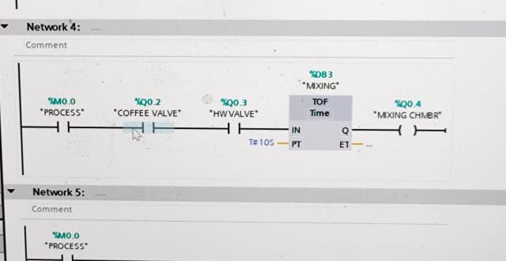

# Coffee Maker PLC Program

A TIA Portal ladder program for a coffee maker machine on a Siemens S7-1200. Built during an internship at PT Kereta Api Indonesia.

## Overview

| | |
|---|---|
| **PLC** | S7-1200 CPU 1215C DC/DC/RLY |
| **Software** | TIA Portal V14 |
| **Language** | Ladder logic |

## Mixing network

| Address | Signal |
|---|---|
| `%M0.0` | PROCESS |
| `%Q0.2` | COFFEE VALVE |
| `%Q0.3` | HW VALVE |
| `%DB3` | MIXING, TOF timer set to 10 s |
| `%Q0.4` | MIXING CHMBR |

The network runs from PROCESS through the two valve signals into the TOF timer, which drives the mixing chamber output.

## Repository contents

| Path | Contents |
|---|---|
| `tia-portal-project/` | TIA Portal project, opened with `Coffee maker machine.ap14` |
| `images/` | Ladder screenshot |

Opening the project requires TIA Portal V14 or newer.
